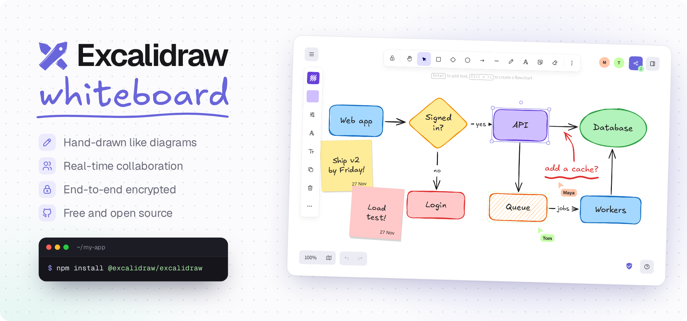

<p align="center">
  <a href="https://excalidraw.com" target="_blank" rel="noopener">
    <picture>
      <source media="(prefers-color-scheme: dark)" srcset=".github/assets/banner-dark.png">
      
    </picture>
  </a>
</p>

<p align="center">
  <a href="https://excalidraw.com"><b>Excalidraw Editor</b></a> ·
  <a href="https://plus.excalidraw.com/docs/sdk">Documentation</a> ·
  <a href="https://www.npmjs.com/package/@excalidraw/excalidraw">npm</a> ·
  <a href="https://plus.excalidraw.com/blog">Blog</a> ·
  <a href="https://plus.excalidraw.com">Excalidraw+</a>
</p>

<p align="center">
  <a href="https://github.com/excalidraw/excalidraw/blob/master/LICENSE">
    </a>
  <a href="https://www.npmjs.com/package/@excalidraw/excalidraw">
    </a>
  <a href="https://plus.excalidraw.com/docs/sdk/contributing">
    </a>
  <a href="https://discord.gg/UexuTaE">
    </a>
  <a href="https://deepwiki.com/excalidraw/excalidraw">
    </a>
  <a href="https://twitter.com/excalidraw">
    </a>
</p>

An open source virtual whiteboard with a hand-drawn style, collaborative and end-to-end encrypted. Sketch diagrams, wireframes or whatever you like at [excalidraw.com](https://excalidraw.com), or embed the editor in your own app with the [`@excalidraw/excalidraw`](https://www.npmjs.com/package/@excalidraw/excalidraw) React component.

## Features

The Excalidraw editor (npm package) supports:

- 💯 **Free and open source**: MIT licensed.
- 🎨 **Infinite canvas**: zoom and pan without running out of room, with a minimap to find your way around.
- ✍️ **Hand-drawn style**: shapes, arrows and text that look sketched, with a choice of fonts, in light or dark mode.
- ⚒️ **Wide range of tools**: rectangle, diamond, ellipse, arrow, line, free-draw, text, sticky notes, frames, web embeds, laser pointer, eraser and more.
- ➡️ **Arrows that follow your shapes**: arrow binding, labeled arrows and elbow arrows.
- 🔀 **Flowcharts from the keyboard**: Ctrl/Cmd+arrow keys add the next node, Alt+arrow keys move between nodes.
- 🧜 **Mermaid diagrams**: paste a Mermaid definition and get shapes you can keep editing, with [Mermaid to Excalidraw](https://github.com/excalidraw/mermaid-to-excalidraw).
- 📊 **Charts**: paste spreadsheet data and get a bar, line or radar chart.
- 📷 **Images and shape libraries**: drop in images and crop them, and reuse shapes from [public libraries](https://libraries.excalidraw.com) or your own.
- 🔍 **Command palette and search**: run any action, or find text in the scene, from the keyboard.
- 🖼️ **Export to PNG, SVG and clipboard**: or save the drawing as an `.excalidraw` JSON file, an open format.
- 🌐 **Localization (i18n)**: translated by the community.
- 🏗️ **Customizable**: props, an imperative API and UI you can extend when you embed it.

## Excalidraw.com

The app hosted at [excalidraw.com](https://excalidraw.com) is a minimal showcase of what you can build with Excalidraw. Its [source code](https://github.com/excalidraw/excalidraw/tree/master/excalidraw-app) is part of this repository as well, and the app features:

- 📡 **PWA support**: works offline.
- 🤼 **Real-time collaboration**: draw together in the same scene.
- 🔒 **End-to-end encryption**: the server can't read what you draw.
- 💾 **Local-first**: autosaves to the browser.
- 🔗 **Shareable links**: export to a read-only link you can share with others.
- ✨ **Generative AI**: text to diagram and wireframe to code.

We'll be adding these features as drop-in plugins for the npm package in the future.

You can also run this app on your own infrastructure. The repository ships a `Dockerfile` and a `docker-compose.yml`, or you can have a managed instance set up for you in one click, with storage, backups and a free subdomain included:

[](https://zenith.hosting/host/excalidraw)

## Quick start

**Note:** the following instructions are for installing the Excalidraw [npm package](https://www.npmjs.com/package/@excalidraw/excalidraw) when integrating Excalidraw into your own app. To run the repository locally for development, please refer to our [Development Guide](https://plus.excalidraw.com/docs/sdk/development).

```bash
npm install react react-dom @excalidraw/excalidraw
# or
yarn add react react-dom @excalidraw/excalidraw
```

To try unreleased changes, use `@excalidraw/excalidraw@next`.

```tsx
import { Excalidraw } from "@excalidraw/excalidraw";
import "@excalidraw/excalidraw/index.css";

export default function App() {
  return (
    <div style={{ height: "100vh" }}>
      <Excalidraw />
    </div>
  );
}
```

Excalidraw fills its parent, so the parent needs a height. See [installation](https://plus.excalidraw.com/docs/sdk/excalidraw/installation) and [integration](https://plus.excalidraw.com/docs/sdk/excalidraw/integration) for Next.js and other setups.

## Excalidraw+

[Excalidraw+](https://plus.excalidraw.com) is the hosted workspace for teams, built on this editor. Using it also supports the open source project. On top of everything above, you get:

- ☁️ **Unlimited scenes, saved to the cloud**: organized in collections, with a dashboard to find them again.
- 👥 **Team workspaces**: access management, sharing with edit or view rights, read-only links and embeds.
- 💬 **Comments, voice hangouts and screensharing**: discuss a scene where you draw it.
- 🎞️ **Presentations**: turn frames into slides, present them live and export them to PDF or PPTX.
- ✨ **More AI**: 100 requests a day for text to diagram and wireframe to code, or bring your own key.
- 🤖 **MCP server and REST API**: let AI agents and scripts read and edit your scenes. See the [MCP](https://plus.excalidraw.com/docs/mcp) and [API](https://plus.excalidraw.com/docs/api) docs.
- 🔌 **Integrations**: bring your scenes into the tools your team already works in.
- 🏢 **Enterprise ready**: SSO (SAML or OIDC), admin controls for sharing and AI, and audit logs.
- 🔐 **Security**: two-factor authentication that admins can require of every member, encryption at rest and in transit, daily backups and SOC 2 Type 2. See [security and compliance](https://plus.excalidraw.com/security-and-compliance).

**[Try Excalidraw+ free for 14 days](https://plus.excalidraw.com)** · [Pricing](https://plus.excalidraw.com/pricing)

## Excalidraw CLI

The [Excalidraw CLI](https://github.com/excalidraw/cli) brings Excalidraw to your terminal, scripts and AI agents. It renders drawings and converts Mermaid diagrams on your computer, free and without an account:

```bash
npx @excalidraw/cli render drawing.excalidraw --out drawing.png
npx @excalidraw/cli mermaid flow.mmd --out flow.excalidraw
```

Log in to Excalidraw+ and it manages your workspace too: scenes, collections, share links and presentations. `excalidraw mcp` gives AI agents the Excalidraw+ drawing tools through the same login. See the [CLI docs](https://plus.excalidraw.com/docs/cli).

## Documentation

📚 **[plus.excalidraw.com/docs/sdk](https://plus.excalidraw.com/docs/sdk)**

- [Installation](https://plus.excalidraw.com/docs/sdk/excalidraw/installation) and [integration](https://plus.excalidraw.com/docs/sdk/excalidraw/integration)
- [API: props, methods and utilities](https://plus.excalidraw.com/docs/sdk/excalidraw/api)
- [Customizing styles](https://plus.excalidraw.com/docs/sdk/excalidraw/customizing-styles)
- [FAQ](https://plus.excalidraw.com/docs/sdk/excalidraw/faq)
- [Self-hosting the open source editor](https://plus.excalidraw.com/docs/self-hosting/excalidraw-open-source-selfhosting)
- [Development](https://plus.excalidraw.com/docs/sdk/development) and [the codebase](https://plus.excalidraw.com/docs/sdk/codebase/json-schema)

## Contributing

- Missing something or found a bug? [Report here](https://github.com/excalidraw/excalidraw/issues).
- Want to contribute? Check out our [contribution guide](https://plus.excalidraw.com/docs/sdk/contributing) or let us know on [Discord](https://discord.gg/UexuTaE).
- Want to help with translations? See the [translation guide](https://plus.excalidraw.com/docs/sdk/contributing#translating).

## Integrations

- [npm package](https://www.npmjs.com/package/@excalidraw/excalidraw)
- [Excalidraw CLI](https://github.com/excalidraw/cli)
- [Mermaid to Excalidraw](https://github.com/excalidraw/mermaid-to-excalidraw)
- [Excalidraw MCP](https://github.com/excalidraw/excalidraw-mcp)
- [VScode extension](https://marketplace.visualstudio.com/items?itemName=pomdtr.excalidraw-editor)

## Who's integrating Excalidraw

[Google Cloud](https://googlecloudcheatsheet.withgoogle.com/architecture) • [Meta](https://meta.com/) • [CodeSandbox](https://codesandbox.io/) • [Obsidian Excalidraw](https://github.com/zsviczian/obsidian-excalidraw-plugin) • [Replit](https://replit.com/) • [Slite](https://slite.com/) • [Notion](https://notion.so/) • [HackerRank](https://www.hackerrank.com/) • and many others

## Sponsors & support

If you like the project, you can become a sponsor at [Open Collective](https://opencollective.com/excalidraw) or use [Excalidraw+](https://plus.excalidraw.com/).

## Thank you for supporting Excalidraw

[](https://opencollective.com/excalidraw/tiers/sponsors/0/website) [](https://opencollective.com/excalidraw/tiers/sponsors/1/website) [](https://opencollective.com/excalidraw/tiers/sponsors/2/website) [](https://opencollective.com/excalidraw/tiers/sponsors/3/website) [](https://opencollective.com/excalidraw/tiers/sponsors/4/website) [](https://opencollective.com/excalidraw/tiers/sponsors/5/website) [](https://opencollective.com/excalidraw/tiers/sponsors/6/website) [](https://opencollective.com/excalidraw/tiers/sponsors/7/website) [](https://opencollective.com/excalidraw/tiers/sponsors/8/website) [](https://opencollective.com/excalidraw/tiers/sponsors/9/website) [](https://opencollective.com/excalidraw/tiers/sponsors/10/website)

<a href="https://opencollective.com/excalidraw#category-CONTRIBUTE" target="_blank"></a>

Last but not least, we're thankful to these companies for offering their services for free:

[](https://vercel.com) [](https://sentry.io) [](https://crowdin.com)
